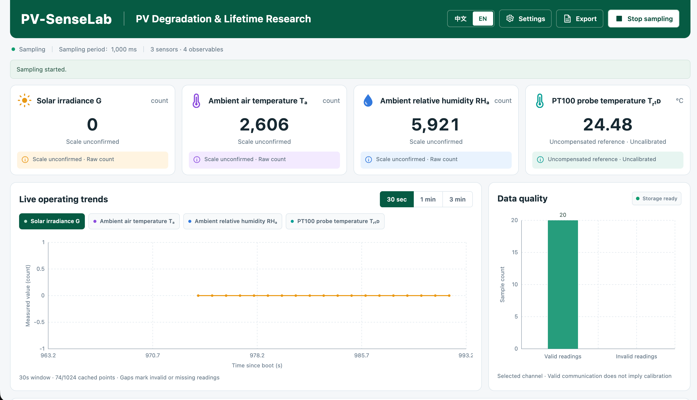

# PV-SenseLab

### Multi-Physics Sensing for Photovoltaic Health and Lifetime Assessment

PV-SenseLab is a laboratory research project investigating how environmental exposure, thermal conditions, and electrical behavior can be combined to assess the health of a photovoltaic (PV) module. Its long-term aim is to distinguish reversible performance losses from persistent degradation, estimate remaining useful life, and evaluate maintenance decisions using measured evidence.

The central question is: **when a solar panel produces less power, how much of the change comes from its operating conditions, and how much reflects a change in the panel itself?** Answering it connects electronic instrumentation, semiconductor physics, environmental engineering, and uncertainty-aware data analysis.

**Current milestone — v0.6.0:** a working ESP32-S3 sensing and data-recording prototype with an offline, bilingual dashboard. Actual PV voltage/current/power measurement is the next integration milestone; automated I–V tracing, degradation diagnosis, and lifetime prediction remain research objectives.



*User-provided screenshot of the running bench dashboard. Irradiance and ambient temperature/humidity are shown as raw counts because their conversion factors await verification. The PT100 reading is an uncompensated, uncalibrated reference temperature. The screen demonstrates acquisition and visualization; it is not a calibrated PV performance or lifetime result.*

## From measurements to lifetime assessment

The intended workflow combines **multi-physics observations with actual electrical output**:

| Stage | Engineering question | Deliverable and present status |
|---|---|---|
| **1. Establish the measurement foundation** | Can each observation be acquired, timestamped, interpreted, and preserved correctly? | Sensor communication, raw recording, quality flags, and dashboard implemented. Calibration and installation validation remain open. |
| **2. Measure electrical performance** | What power does the module deliver under a known load and measured conditions? | Next milestone: integrate and calibrate V/I sensing, calculate operating-point power, and establish a repeatable baseline. I–V/P–V scanning requires the protected load hardware. |
| **3. Diagnose performance loss** | Can controlled changes be separated from weather, temperature, and measurement artifacts? | Planned experiments and constrained physical modeling; no completed diagnostic model or accuracy claim. |
| **4. Assess degradation and useful life** | Does condition-adjusted performance change persist over time, and when might it cross a defined end-of-life criterion? | Long-term objective requiring longitudinal observations, validated models, uncertainty estimates, and independent evaluation. No lifetime prediction is currently produced. |

A single power reading cannot establish a module's remaining life. The immediate goal is to build a credible measurement baseline from which those later questions can be investigated.

## Instrumentation and embedded design

Three connected sensors currently provide four observables:

| Observable | Measurement path | Interpretation boundary |
|---|---|---|
| Solar irradiance, **G** | SM9569 over RS485 / Modbus RTU | Engineering-unit scale and installation plane await verification; raw counts are retained. |
| Ambient air temperature, **Tₐ** | SM7820B, first register | Conversion factor awaits verification. |
| Ambient relative humidity, **RHₐ** | SM7820B, second register | Environmental context; not a direct measurement of moisture inside a PV module. |
| PT100 probe temperature, **T_RTD** | MAX31865 over SPI | Three physical leads, compensation disabled in the present reference mode. Not yet validated as module-backsheet or cell temperature. |

The INA226 voltage/current driver is implemented, but its module is disconnected and disabled in the current dashboard configuration. The chip's capabilities do not establish the accuracy or safe operating range of a third-party board; those depend on the shunt, wiring, supply, and calibration. See [TI's INA226 documentation](https://www.ti.com/product/INA226).

The prototype deliberately uses available sensor modules to validate acquisition before committing to custom circuitry. The intended custom system separates the **sensing board**, **programmable electronic load**, and **cleaning actuator**. Their [module specifications and interfaces](hardware/README.md) are design inputs; finished custom schematics, PCBs, and power-stage hardware have not been delivered.

Several design choices make the measurement chain inspectable:

- **Shared-bus discipline.** The two Modbus instruments use distinct addresses, 1 and 2, on a 9600-baud bus. Firmware schedules one transaction at a time and preserves requests, responses, CRC failures, and timeouts. The computer console is independently configured at 115200 baud.
- **Explicit acquisition timing.** Conversion waits are handled by state machines. Device/boot identifiers and monotonic timestamps distinguish samples across restarts; estimated timing and unsynchronized UTC remain visible.
- **Bounded resources.** The ESP32 hosts its own Wi-Fi access point and serves HTML/CSS/JavaScript without a CDN. A 1,024-point RAM history supports plotting; append-only Flash logs preserve fuller records. Storage faults or low remaining space stop sampling instead of silently overwriting logs.
- **Measurement before interpretation.** Unknown scale factors produce raw counts, invalid engineering values remain `null`, and communication success is kept separate from calibration status. The PT100 compensation issue is recorded rather than hidden behind a numerical correction.

The [MAX31865](https://www.analog.com/en/products/max31865.html) measures RTD resistance relative to a reference resistor. Consequently, the reference resistance, lead configuration, contact resistance, self-heating, and probe placement all matter. The current 428 Ω setting comes from an in-circuit multimeter report; it is not a precision calibration.

## Physical basis of the research

### Operating power and maximum power are different measurements

At a particular load condition,

$$
P_{\mathrm{op}} = VI.
$$

This is the actual operating-point power. Establishing the available maximum requires a qualified sweep or another validated method of finding the maximum-power point:

$$
P_{\max}=\max_{(V,I)\,\in\,\mathcal{S}}(VI),
\qquad FF=\frac{P_{\max}}{V_{oc}I_{sc}}.
$$

Here, $\mathcal{S}$ is the accepted scan domain. A discrete scan may miss the true peak, and fill factor is meaningful only when the open-circuit and short-circuit endpoints are adequately measured or explicitly estimated. The [I–V tracer specification](docs/IV_TRACER_SPEC.md) therefore treats endpoint reachability, sampling skew, load burden, and scan resolution as engineering questions.

### Environmental context is needed to interpret a power change

Power varies with irradiance and temperature even when the module has not degraded. Established performance models, such as [PVWatts](https://pvlib-python.readthedocs.io/en/stable/reference/generated/pvlib.pvsystem.pvwatts_dc.html), make those dependencies explicit. This motivates comparing measurements under matched conditions or using a validated correction model before interpreting a trend as degradation.

For this project, that also means checking sensor geometry and spectral response, distinguishing probe temperature from cell temperature, and accounting for temperature changes caused by cleaning. Ambient humidity is useful context for exposure studies, but correlation with power is insufficient evidence of an internal failure mechanism.

### Equivalent-circuit parameters provide testable hypotheses

A planned modeling baseline is the single-diode equivalent circuit:

$$
I=I_{ph}-I_0\left[\exp\left(\frac{V+IR_s}{a}\right)-1\right]
-\frac{V+IR_s}{R_{sh}},
\qquad a=\frac{nN_sk_BT_{cell}}{q}.
$$

The parameters represent photogenerated current, diode saturation current, effective series and shunt resistances, and a thermal-voltage-related term. The formulation follows [Sandia's PV Performance Modeling Collaborative](https://pvpmc.sandia.gov/modeling-guide/2-dc-module-iv/single-diode-equivalent-circuit-models/) and the [pvlib single-diode reference](https://pvlib-python.readthedocs.io/en/stable/reference/generated/pvlib.pvsystem.singlediode.html); pvlib is a theoretical reference, not a current firmware dependency.

The proposed estimator will impose physical bounds and examine parameter sensitivity, correlation, multiple starting points, and uncertainty. Similar-looking curves may support different parameter combinations: a small fitting residual does not establish a unique physical explanation. Partial shading and bypass-diode behavior can also invalidate the uniform single-diode model. [Model identification](docs/EXPERIMENT_PLAN.md#单二极管模型与参数化) is planned, not implemented.

Remaining-life estimation would build on repeated, condition-adjusted performance measurements and diagnostic evidence. It must specify an end-of-life criterion, the operating scenario being projected, and uncertainty in the estimated crossing time. Short-term shading or added resistors cannot substitute for observations of real aging.

## Environmental engineering and maintenance

The environmental objective is to investigate how useful solar generation can be maintained with appropriate use of water, energy, and materials. This makes cleaning a resource-allocation problem as well as a control problem: a temporary increase in output does not, by itself, justify a maintenance action.

The [experimental plan](docs/EXPERIMENT_PLAN.md) proposes clean baselines, controlled soiling, temperature variation, partial shading, and external resistance networks. It calls for matched or corrected pre/post conditions, repeated measurements, independent condition labels, and retention of unsuccessful trials. External resistors represent imposed losses at a defined measurement boundary, not proof that the panel's internal resistance has aged.

A future cleaning study would evaluate recovered electrical energy over a stated observation period alongside actuator energy, water use, and possible surface damage. Any avoided-emissions or lifecycle claim would require additional boundaries and evidence. No water savings, carbon savings, service-life extension, or cleaning benefit has yet been quantified.

## Validation and reproducibility

The [bench verification record](docs/design/VERIFICATION.md) documents a short hardware/API test with 18 accepted readings per observable and no invalid readings during that interval. The embedded page was retrieved from the device and checked against its HTML source. Software tests cover protocol parsing, numeric conversion, bounded history, statistics, append-only host recording, and bilingual UI/CSV behavior.

These checks establish limited implementation evidence. They do not establish measurement accuracy, long-term reliability, or diagnostic performance. Raw bench archives are retained locally and are not included in this public repository; the screenshot is an illustration, not a replacement for the underlying records.

The [data dictionary](docs/DATA_DICTIONARY.md) separates raw values, engineering conversions, quality flags, calibration references, and clock-mapping status. Cleaning, filtering, and model fitting must create derived outputs without altering raw observations. Internal Flash and Git are not substitutes for independently verified backups.

## Running the prototype

1. Install **Arduino-ESP32 3.3.11** and open [`firmware/pv-sensing/siri/siri.ino`](firmware/pv-sensing/siri/siri.ino). Keep its companion headers together; no additional Arduino libraries are required.
2. Select **ESP32S3 Dev Module**, verify the actual board/USB configuration, and follow the [firmware instructions](firmware/pv-sensing/siri/README.md). Check module supply and logic levels before connecting hardware.
3. Open the serial console at **115200 baud** and send `web` followed by a newline. Connect to the reported `PV-SenseLab-xxxx` hotspot using its per-boot password.
4. Visit **http://192.168.4.1/** and explicitly start sampling. Use **中文 / EN** to switch languages. CSV exports the browser's bounded history; JSONL downloads provide device raw logs.

Edit the page in [`web/index.html`](firmware/pv-sensing/web/index.html), then regenerate its embedded representation before rebuilding:

```sh
python3 firmware/pv-sensing/embed_dashboard.py
```

Optional host capture uses Python's standard library on macOS/Linux:

```sh
python3 software/capture_serial.py --help
```

Deterministic software tests use explicit protocol/mathematical fixtures, not fabricated experiments:

```sh
python3 -m unittest discover -s tests/unit -p 'test_*.py'
node tests/unit/test_dashboard_ui.cjs
c++ -std=c++17 -Wall -Wextra -Werror tests/unit/test_sensor_math.cpp -o /tmp/pv-sensor-test
/tmp/pv-sensor-test
c++ -std=c++17 -Wall -Wextra -Werror tests/unit/test_dashboard_store.cpp -o /tmp/pv-store-test
/tmp/pv-store-test
```

Node.js 18+ is needed only for UI logic tests. Compiler/SDK setup is platform-dependent; the commands above assume a POSIX shell.

## Next engineering milestones

1. Verify sensor scale factors, establish calibration records, resolve PT100 compensation, and validate irradiance/probe placement.
2. Integrate protected V/I measurement and reference comparisons; document the load condition before reporting actual PV power.
3. Design and review the electronic load in EasyEDA, including MOSFET linear safe operating area, heat dissipation, grounding, fault isolation, and calibration access; then validate I–V scans.
4. Execute controlled loss experiments and assess whether model parameters and fault hypotheses are distinguishable.
5. Build longitudinal evidence for degradation and remaining-life assessment; evaluate maintenance only after its electrical, environmental, and mechanical prerequisites are met.

The approved experimental baseline is a standalone **10–20 W low-voltage module**, isolated from rooftop installations, inverters, and grid-connected equipment. A purchased 50 W panel is recorded in the project specifications but has not been approved for the power path. Neither a dashboard nor firmware provides authorization to bypass power-stage protection. See the [hardware requirements and open design decisions](docs/HARDWARE_SPEC.md).

## Repository guide

| Location | Contents |
|---|---|
| [`firmware/`](firmware/README.md) | ESP32-S3 acquisition, device API, and offline dashboard |
| [`hardware/`](hardware/README.md) | Sensing/load/cleaning specifications; custom circuit work remains pending |
| [`software/`](software/README.md) | Host-side raw serial capture |
| [`models/`](models/README.md) | Planned physical modeling responsibilities; no implemented estimator |
| [`experiments/`](experiments/README.md) | Experimental responsibilities and protocol organization |
| [`data/`](data/README.md) | Raw/derived/calibration data rules; raw measurements excluded from Git |
| [`tests/`](tests/README.md) | Software tests and future integration/hardware validation requirements |
| [`paper/`](paper/README.md) | Planned manuscript and figure organization; no publication claimed |

The English overview is supported by detailed engineering specifications, currently maintained primarily in Chinese: [requirements](docs/PRD.md), [architecture](docs/ARCHITECTURE.md), [sensor specification](docs/SENSOR_SPEC.md), [bill of materials](docs/BOM.md), and the [seven-week planning baseline](docs/ROADMAP.md). That schedule describes intended gates rather than completed weeks. Actual progress and unresolved work are tracked in [`todo.md`](todo.md); collaboration rules are in [`AGENTS.md`](AGENTS.md).
