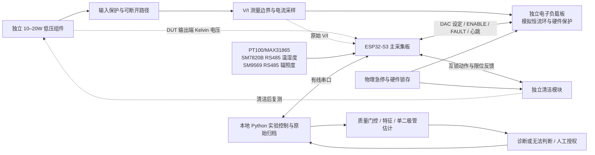

# 系统架构

版本：0.1；日期：2026-10-20；状态：设计草案，尚未实现。

## 架构决策

1. 采用 ESP32-S3 主采集板 + 独立模拟闭环可编程电子负载板 + 独立清洁执行模块。负载板独立是电路和功率职责独立，当前不另引入第二个 MCU；若时序或隔离验证要求变更，先修订协议再选型。
2. 恒流模拟环在负载板本地闭合；ESP32-S3 负责设定值、采样调度和扫描序列，Python 负责任务、归档、分析。硬件关断优先于固件，固件保护优先于主机流程。
3. 初期主机使用有线 USB 串口；物理路径为原生 USB 或桥接器 TBD-07。不以 Wi-Fi 提供必要控制或安全链路。
4. V/I 科研测量链与负载控制反馈分别定义；控制分流电阻不能未经标定直接视作最终计量通道。高速 V/I 与较慢的环境采集异步记录，通过时间与陈旧程度关联。
5. 数据先采用追加式 JSONL/CSV 与 manifest，不引入数据库、微服务或完整 Web。模型估计作为离线、可重放的独立 Python 计算职责。

## 功率路径与信息流

图为基线接线；等效损耗网络接入时，将其纳入 DUT 并在其输出端 Kelvin 测量，登记支路拓扑。图中所有电源电压、GPIO、连接器 pinout 和隔离实现均为 TBD。原理图须明确电压取样点、电流分支、辅助负载与断开位置，避免测量辅助电路电流被遗漏或重复计入。

2026-10-25 更新：SM7820B正确手册已确认RS485 Modbus温湿度，与SM9569共用UART1/已有模块；两者默认9600/8N1且地址1，须先配置不同实物地址。PT100/MAX31865仍为SPI，INA226为I²C原型。供电/电平/参考地/保护/倍率及负温歧义仍需实物/厂家核对，无硬件联调结果。

## 模块职责与目录

| 目录 | 职责与输入输出 | 不负责 |
|---|---|---|
| hardware/pv-sensing-board | 测量前端、电源、传感、ESP32-S3、逻辑接口 | 吸收 PV 主功率 |
| hardware/pv-electronic-load | 吸收能量、DAC/模拟环、局部保护与回读 | 研究模型与永久存档 |
| hardware/cleaning-module | 驱动、限位、堵转/超时、运动防护 | 在扫描期间动作 |
| firmware | 采集、扫描、互锁、时钟与故障事件 | 曲线可信性最终判定和复杂模型 |
| software | Python 有线传输、实验编排、文件归档、特征与分析入口 | 绕过固件/硬件限制 |
| models | 单二极管正向/受约束估计、辨识性和残差 | 无条件返回诊断类别 |
| experiments / data | 实验规程与追加式记录、标定、派生产物 | 覆盖原始数据 |
| tests / paper | 验证用例与证据；论文和可追溯图表 | 冒充尚未完成的结果 |

## 控制状态机

统一状态：`BOOT` → `SELF_TEST` → `SAFE_IDLE`。前提检查失败进入 `FAULT_LATCHED`。

- `SAFE_IDLE`：负载关断、清洁停止。允许读取状态、同步时钟、提交并校验配置，也允许非驱动性的只读采样/校准记录；未标定通道以原码和 UNCALIBRATED 保存，不能据此 ARM。首次校准用经审查的限流标准源/无源夹具，不因校准需求绕过负载保护。
- `ARMED`：本次任务及标定、参数边界、存储就绪、会话租约检查已通过；不是持久授权，复位失效。
- `SCANNING`：仅允许负载扫描，禁止清洁。结束后必须关断并进入 `SAFE_IDLE`；取消和异常保留部分点。
- `CLEANING`：仅在扫描结束、负载断开反馈有效、限位和物理条件合格且本次明确授权后进入；完成后返回 `SAFE_IDLE`。
- `RECOVERY_WAIT`：由主机管理的闭环阶段，器件安全状态仍为 `SAFE_IDLE`。环境稳定后建立新的 scan_id，执行复测，不复用旧曲线。
- `FAULT_LATCHED`：硬件和固件停止吸收/运动，锁存原因；人工排查并明确复位，再自检。不能自动续跑或以重连恢复旧任务。

任意活动状态遇到急停、负载故障、时钟/采样异常、越限、存储背压、心跳超时或清洁限位异常，安全关断并记录故障。温湿度等非关键通道失效可以阻止新实验并保留监测数据；关键保护测温/电流失效必须停机。哪些通道为关键及所有时限在 TBD-16、20 冻结。

## 时间与数据流

设备以 `device_id + boot_id + t_mono_us` 表示采样时刻；Python 通过带往返时延记录的映射建立 UTC，保留不确定度，复位后重建。环境传感器各有采样时间，不能用最新值伪装同步测量；关联需检查 age 与有效标志。

传输 seq 发现丢包，点 point_index 发现扫描缺点；有限缓冲耗尽必须中止扫描，不能静默覆盖。主机临时写入 run 目录，文件落盘、计数和摘要校验后才能标为 complete；中断也提交 aborted/partial manifest。状态机与持久化细节见 [协议](API_PROTOCOL.md) 和 [数据字典](DATA_DICTIONARY.md)。

## 技术取舍与替代条件

| 决策 | 理由 | 何时重审 |
|---|---|---|
| 两板、无额外负载 MCU | 减少维护与同步复杂度，功率环就近闭合 | 板间距离/隔离或同步预算不满足 |
| 外置科研 ADC 为优先候选 | 可按量程、同步和误差预算选型；型号 TBD | 片内 ADC 实测足以满足冻结预算时允许简化 |
| DAC 而非未经验证 PWM 直接驱动门极 | 设定值与模拟环明确，避免把滤波后 PWM 当已验证方案 | DAC 选型/噪声/成本审查后调整 |
| 本地文件与 CLI | 原始证据直接可审计，不引入无必要平台 | 实际查询规模证明需要其他存储 |

以上为设计取舍，不构成 ADC 精度、控制稳定性、通信带宽或系统性能承诺。验证入口见 [tests](../tests/README.md)。
